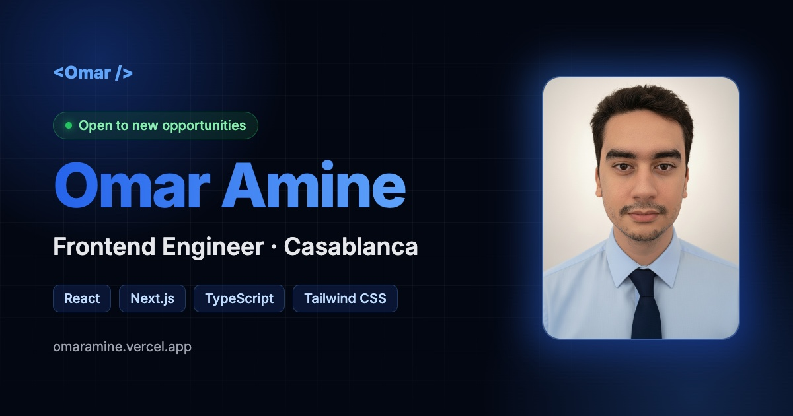

# Omar Amine · Portfolio

My personal portfolio: projects, in-depth case studies, work experience, a downloadable CV and an AI assistant that answers recruiters' questions about my work.

**Live:** [omaramine.vercel.app](https://omaramine.vercel.app)



## Features

- **Projects and case studies:** each project links to a case study page (`/projects/[slug]`) covering the problem, my role, key decisions, the hardest challenge, a gallery and a demo video.
- **"Ask my AI" chat:** a Google Gemini assistant grounded only in the site's own data. It knows which page you're on, and it falls back to a second model when the first hits its quota.
- **Contact form:** sends me a styled HTML email through Nodemailer and Gmail.
- **Dark mode:** turns on automatically at night (7pm to 7am, visitor's local time), with a manual toggle and no flash on load.
- **SEO:** metadata, Open Graph image, `sitemap.xml` and `robots.txt`.
- **Performance:**
  - The home page uses Incremental Static Regeneration (ISR); case study pages are generated statically.
  - Images and videos load lazily.
  - Video segments are embedded with the privacy-enhanced YouTube player.
- **Resilient data:**
  - Projects are stored in MongoDB.
  - If the database is empty or unreachable, the site falls back to the project list in code.
  - A `/api/health` endpoint reports the database status.

## Tech stack

| Area | Tools |
| --- | --- |
| Framework | Next.js 16 (App Router), React 19, TypeScript |
| Styling | Tailwind CSS |
| Data | MongoDB with Mongoose |
| AI | Google Gemini API |
| Email | Nodemailer (Gmail) |
| Hosting | Vercel, Vercel Analytics |

## Project structure

```
app/
  page.tsx               Home page (ISR, revalidates hourly)
  projects/[slug]/       Case study pages (statically generated)
  api/chat/              Gemini chat endpoint
  api/contact/           Contact form email endpoint
  api/projects/          Projects from MongoDB
  api/health/            Health check (database status)
  sitemap.ts, robots.ts  SEO
components/              UI sections (Hero, Projects, Experience, Skills, ChatWidget...)
lib/
  profile.ts             Bio, experience, skills, testimonials
  projectData.ts         Project cards (also the database seed and fallback)
  caseStudies.ts         Case study content
  chatContext.ts         Builds the AI assistant's knowledge from the data above
  db.ts, models.ts       MongoDB connection and schema
scripts/seed.ts          Seeds MongoDB from lib/projectData.ts
cv/cv.html               Source for public/Omar-Amine-CV.pdf
og/og-image.html         Source for public/og-image.jpg
```

Most content lives in `lib/`. The pages and the AI assistant both read from those files, so they stay in sync.

## Getting started

Requirements: Node.js 20.9 or newer.

```bash
git clone https://github.com/DoDaa3/my-portfolio.git
cd my-portfolio
npm install
```

Create `.env.local` in the project root:

```bash
MONGODB_URI=mongodb+srv://...        # MongoDB connection string
EMAIL_USER=you@gmail.com             # Gmail account that sends contact emails
EMAIL_PASS=xxxx-xxxx-xxxx-xxxx       # Gmail app password (not your normal password)
GEMINI_API_KEY=...                   # Google AI Studio API key
# GEMINI_MODELS=gemini-2.5-flash-lite,gemini-2.5-flash   # optional, tried in order
```

Every variable is optional for local development. Without a database, the site uses the project list in code. The chat and contact form only work once their keys are set.

```bash
npm run dev
```

Then open [http://localhost:3000](http://localhost:3000).

## Scripts

| Command | What it does |
| --- | --- |
| `npm run dev` | Start the dev server |
| `npm run build` | Production build |
| `npm start` | Serve the production build |
| `npm run typecheck` | Type-check with `tsc` |
| `npm run seed` | Replace the projects in MongoDB with `lib/projectData.ts` |

## Updating content

- **Projects:**
  1. Edit `lib/projectData.ts`.
  2. Run `npm run seed` so the database matches.
  3. Add or edit the matching case study in `lib/caseStudies.ts`.
- **CV:** edit `cv/cv.html`, then regenerate the PDF and check that it is still one page:
  ```bash
  "/Applications/Google Chrome.app/Contents/MacOS/Google Chrome" --headless=new \
    --no-pdf-header-footer --print-to-pdf=public/Omar-Amine-CV.pdf "file://$PWD/cv/cv.html"
  ```
- **Link preview image:** edit `og/og-image.html`. The command to regenerate the image is in the comment at the top of that file.

## Deployment

The site deploys to Vercel automatically on every push. Set the same environment variables in the Vercel project settings.

## Contact

- **Portfolio:** [omaramine.vercel.app](https://omaramine.vercel.app)
- **LinkedIn and GitHub:** linked from the site.
